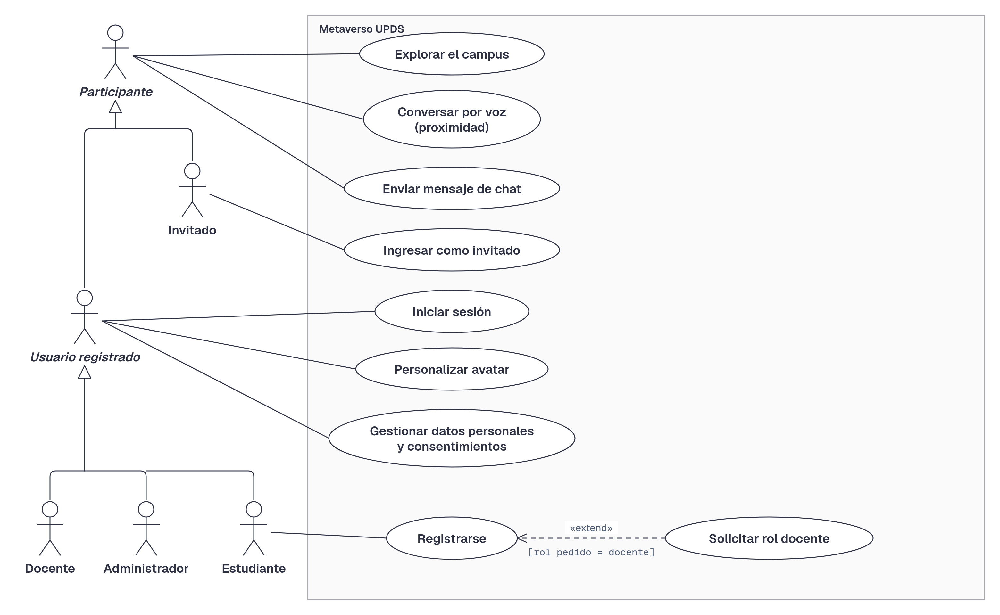
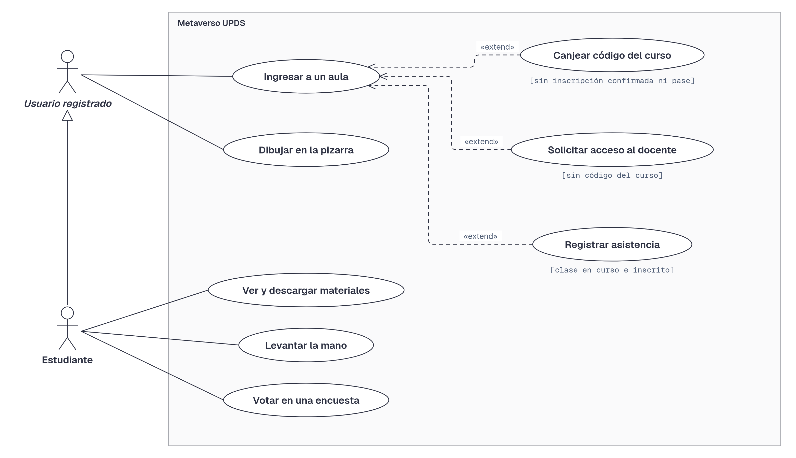
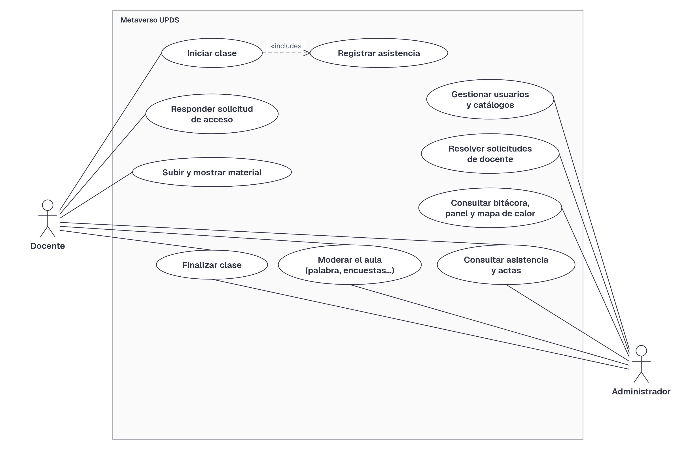

# Casos de uso — Metaverso UPDS

**Versión:** 3.0 · **Fecha:** 2026-11-12 · **Base:** rama `dev`, commit `b6d996f`

Reemplaza a la versión 2.3, que describía el diseño anterior: MySQL/PHP, sin voz ni aulas en tiempo real. Los diagramas UML 2.x están en [`docs/uml/`](uml/README.md), con las fuentes en el código de cada caso de uso y las decisiones de notación.

## Diagramas

**Acceso y campus:** actores con su jerarquía; explorar, voz, chat, ingreso, registro, avatar y datos personales.

**El estudiante en el aula:** ingresar con sus extensiones (código, solicitud y asistencia), pizarra, materiales, mano levantada y encuestas.

**Conducción de la clase y administración.**

## Actores

| Actor | Quién es | Restricciones |
|---|---|---|
| *Participante* (abstracto) | Cualquiera que está en el campus | — |
| Invitado | Entra sin cuenta (`POST /api/auth/guest`); JWT sin fila en la base | Sólo el campus. El servidor rechaza su `join_space` a un aula. |
| *Usuario registrado* (abstracto) | Cualquiera con cuenta | — |
| Estudiante | Rol `estudiante`; es el que crea el registro público | Entra a un aula con inscripción confirmada, con el código del curso o con la aprobación del docente |
| Docente | Rol `docente`, asignado por un administrador | Sólo finaliza sus propias clases y ve los reportes de sus asignaturas |
| Administrador | Rol `administrador` | No inicia clases (`crear-curso` exige rol docente) |

Docente y Administrador comparten la moderación del aula, la finalización de clases y los reportes, pero el administrador **no** hereda del docente.

## Catálogo

| Id | Caso de uso | Actor | Relación | Requisito |
|---|---|---|---|---|
| UC-01 | Explorar el campus | Participante | | RF-02, RF-07 |
| UC-02 | Conversar por voz (proximidad) | Participante | | RF-03, RNF-01 |
| UC-03 | Enviar mensaje de chat | Participante | | — |
| UC-04 | Ingresar como invitado | Invitado | | RF-13 |
| UC-05 | Iniciar sesión | Usuario registrado | | RF-06, RNF-05 |
| UC-06 | Registrarse | Estudiante | | RF-06, RNF-03 |
| UC-07 | Solicitar rol docente | — | «extend» UC-06 `[rol pedido = docente]` | RF-06 |
| UC-08 | Personalizar avatar | Usuario registrado | | RF-01, RF-14 |
| UC-09 | Gestionar datos personales y consentimientos | Usuario registrado | | RNF-03 |
| UC-10 | Ingresar a un aula | Usuario registrado | | RF-02, RNF-05 |
| UC-11 | Canjear código del curso | — | «extend» UC-10 `[sin inscripción confirmada ni pase]` | RF-12 |
| UC-12 | Solicitar acceso al docente | — | «extend» UC-10 `[sin código del curso]` | RF-12 |
| UC-13 | Registrar asistencia | — | «extend» UC-10 `[clase en curso e inscrito]`; incluido por UC-15 | RF-05 |
| UC-14 | Dibujar en la pizarra | Usuario registrado | | RF-04, RF-16 |
| UC-15 | Iniciar clase | Docente | «include» UC-13 | RF-08 |
| UC-16 | Finalizar clase | Docente, Administrador | | RF-11 |
| UC-17 | Responder solicitud de acceso | Docente | | RF-12 |
| UC-18 | Subir y mostrar material | Docente | | RF-17 |
| UC-19 | Ver y descargar materiales | Estudiante | | RF-17 |
| UC-20 | Levantar la mano | Estudiante | | — |
| UC-21 | Votar en una encuesta | Estudiante | | — |
| UC-22 | Moderar el aula (palabra, silenciar, grupos, encuestas, pantalla, grabación) | Docente, Administrador | | RF-03 (silenciar) |
| UC-23 | Consultar asistencia y actas | Docente, Administrador | | RF-08 |
| UC-24 | Gestionar usuarios y catálogos (carreras, asignaturas, espacios) | Administrador | | RF-09 |
| UC-25 | Resolver solicitudes de docente | Administrador | | RF-06 |
| UC-26 | Consultar bitácora, panel y mapa de calor | Administrador | | RF-10, RNF-08 |

"—" significa que el caso existe en el código pero ningún requisito de la propuesta lo nombra todavía.

## Escenarios de UC-13 Registrar asistencia

Como lo hace `registrarAsistencia` (`server/src/helpers.ts:16`) al recibir `join_space`:

1. **Principal.** Hay clase en curso en el aula y el estudiante está inscrito en la asignatura. Si entra dentro de `tolerancia_min` desde el inicio real, se guarda `presente`, y se abre un tramo en `asistencia_tramos`.
2. **Tarde.** Igual, pero pasada la tolerancia: se guarda `tarde`.
3. **Sin clase.** No hay sesión `en_curso`: no se registra nada.
4. **No inscrito.** No se registra; responde `{registrado: false}`.
5. **Reingreso.** Ya tenía asistencia en esta clase. No se duplica (`UNIQUE (sesion_id, usuario_id)`): se conserva el estado de la primera vez y se abre un tramo nuevo. Así quien se cae y vuelve suma sólo el tiempo que estuvo dentro.
6. **Salida.** Al volver al campus o desconectarse se cierra el tramo abierto (`registrarSalida`). Al finalizar la clase se cierran todos los tramos.
7. **Presentes al iniciar.** Al iniciar la clase se registra a quienes ya estaban en el aula (`registrarPresentesEnAula`).

`ausente` no se guarda nunca: el reporte lo calcula como inscritos menos registrados.

## Respuestas de UC-05 Iniciar sesión

| Código | Cuándo |
|---|---|
| 429 | 50 intentos fallidos en 15 minutos desde la misma IP (`limiteLogin`) |
| 401 | El correo no existe, la cuenta está inactiva o la contraseña es incorrecta |
| 423 | La cuenta está bloqueada: 5 fallos seguidos la bloquean 15 minutos |
| 403 | La cuenta no tiene ningún rol asignado |
| 200 | JWT de 8 horas, el usuario con sus roles y su avatar |

Cada intento queda en la `bitacora` (`login_ok`, `login_fallido`, `login_bloqueado`).

## Fuera del sistema actual

- **Recuperar la contraseña uno mismo (RF-18):** no existe. Sólo el administrador la restablece.
- **Programar una clase a futuro:** el Panel de Docente llama a `POST /api/docente/clases`, que no existe en el backend. Las clases se inician en el momento con `POST /api/clases/crear-curso`.
