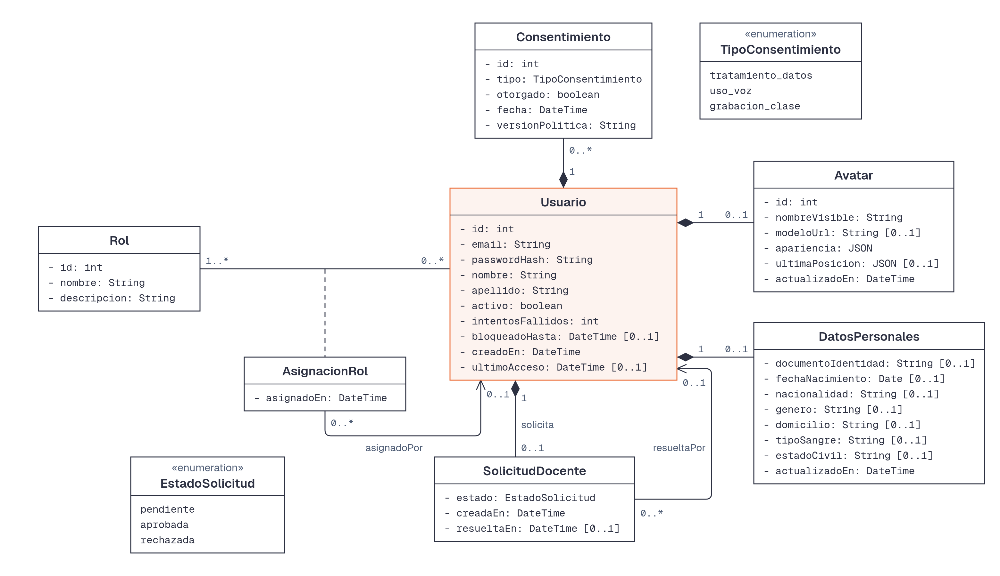
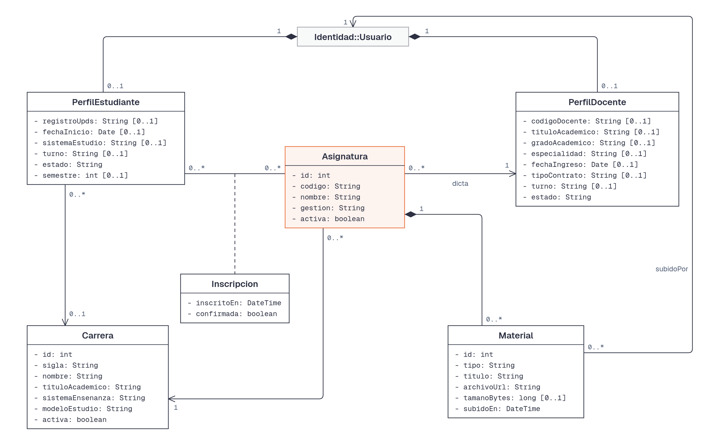
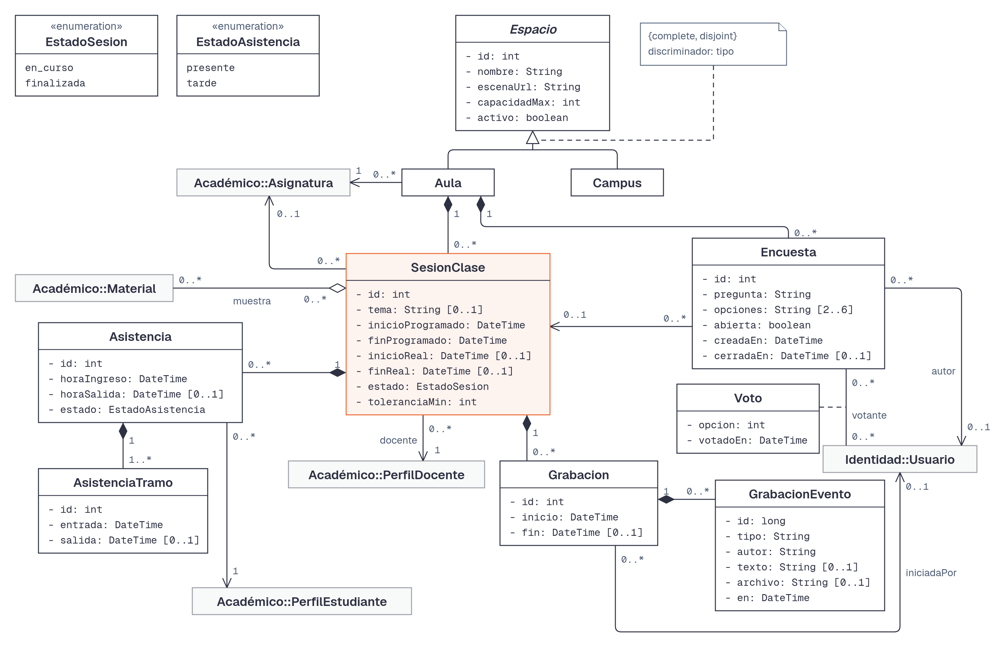
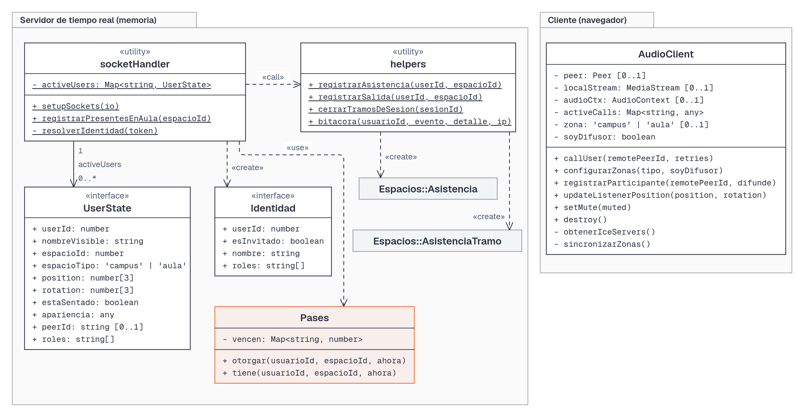
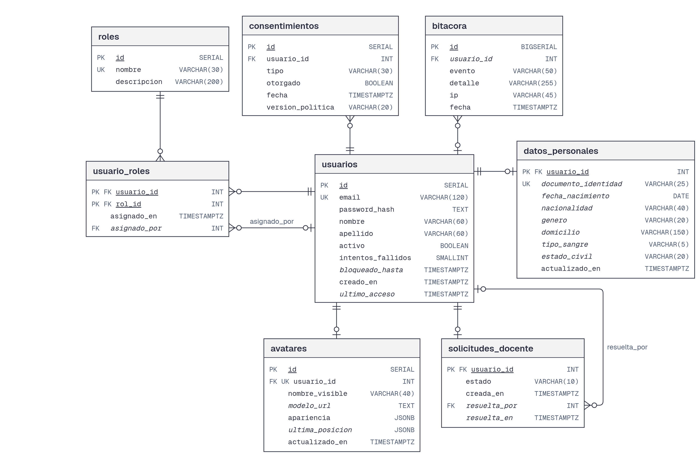
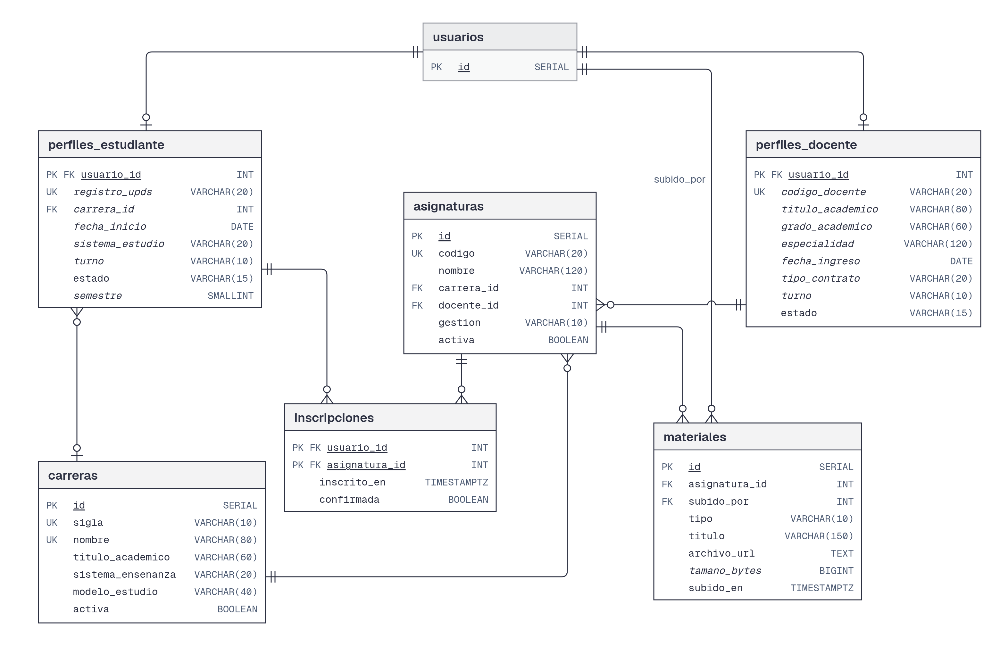
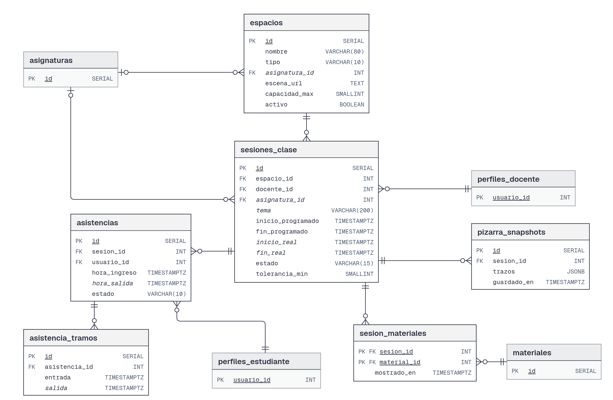
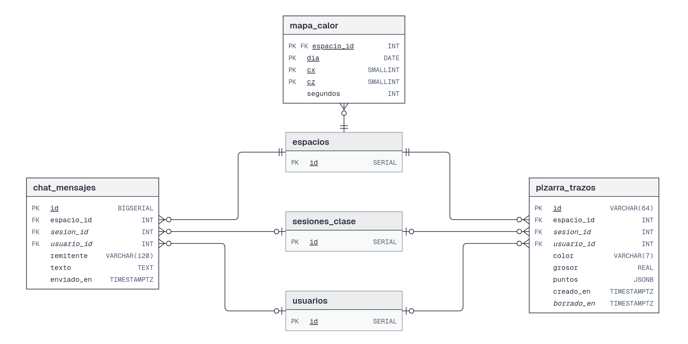
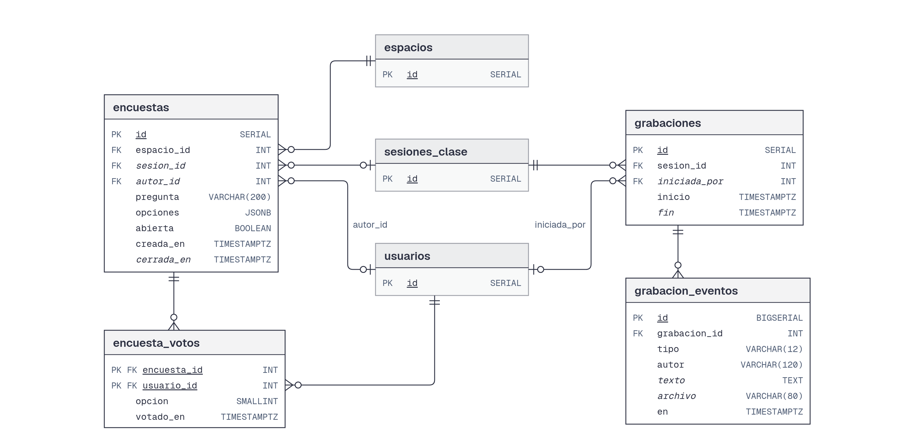

# Modelo de datos y clases — Metaverso UPDS

**Versión:** 3.0 · **Fecha:** 2026-11-12 · **Base:** rama `dev`, commit `b6d996f`

Reemplaza a la versión 2.3, que describía un esquema MySQL anterior: PK simple en `usuario_roles`, tipos `VARCHAR(255)` y `TINYINT`, sin voz, pizarra, chat, encuestas ni grabaciones.

**Fuente de verdad:** las migraciones `server/migrations/0001` a `0010` (`*.up.sql`). El backend las aplica al arrancar (`server/src/migraciones.ts`). Los diagramas UML 2.x, con las fuentes de cada elemento y las decisiones de notación, están en [`docs/uml/`](uml/README.md).

## Diagramas de clases

Una figura por paquete. Las clases de otro paquete aparecen en gris, con el nombre calificado.

## Modelo entidad-relación

Modelo lógico con notación pata de gallo, una figura por dominio.

## Catálogo de tablas (23)

| Tabla | Migración | Para qué | Requisito |
|---|---|---|---|
| `roles` | 0001 | Catálogo RBAC: administrador, docente, estudiante, invitado | RF-06 |
| `usuarios` | 0001 | Credenciales, cuenta activa, bloqueo por intentos fallidos | RF-06, RNF-05 |
| `usuario_roles` | 0001 | N:M usuario–rol, con quién lo asignó | RF-06 |
| `datos_personales` | 0001 | Documento, nacionalidad y demás datos personales (1:0..1) | RNF-03 |
| `consentimientos` | 0001 | Aceptaciones versionadas: datos, voz, grabación | RNF-03 |
| `avatares` | 0001 | Nombre visible, apariencia (JSONB) y última posición en el campus | RF-01, RF-14 |
| `bitacora` | 0001, 0005 | Auditoría de eventos con IP y fecha; índices por fecha y evento | RNF-08 |
| `carreras` | 0001 | Catálogo de carreras | RF-09 |
| `perfiles_estudiante` | 0001 | Datos académicos del estudiante (1:0..1 con usuarios) | RF-06 |
| `perfiles_docente` | 0001 | Datos del docente (1:0..1 con usuarios) | RF-08 |
| `asignaturas` | 0001 | Materias con su código (la llave del aula) y su docente | RF-02, RF-09 |
| `inscripciones` | 0001, 0010 | N:M estudiante–asignatura; `confirmada` indica si se canjeó el código | RF-02, RF-12 |
| `espacios` | 0001 | Campus o aula; toda aula tiene asignatura | RF-02 |
| `sesiones_clase` | 0001 | Cada clase: horario, estado y tolerancia | RF-08, RF-11 |
| `asistencias` | 0001 | Una por estudiante y sesión: primera entrada y estado | RF-05 |
| `asistencia_tramos` | 0003 | Cada entrada y salida del aula, para sumar los minutos efectivos | RF-05 |
| `materiales` | 0001 | Archivos de la asignatura | RF-17 |
| `sesion_materiales` | 0001 | Qué material se mostró en qué clase | RF-17 |
| `pizarra_snapshots` | 0001 | Instantánea oficial de la pizarra de una sesión | RF-04, RF-16 |
| `pizarra_trazos` | 0002 | La pizarra trazo a trazo; borrar marca `borrado_en` | RF-04, RF-16 |
| `chat_mensajes` | 0004 | Historial del chat por espacio | — |
| `mapa_calor` | 0006 | Segundos con gente por celda de 2 × 2 y por día; no guarda quién | RF-10 |
| `encuestas`, `encuesta_votos` | 0007 | Encuestas en vivo del aula y un voto por usuario | — |
| `grabaciones`, `grabacion_eventos` | 0008 | Grabación de la clase como acta: subtítulos y capturas | — |
| `solicitudes_docente` | 0009 | Pedido de rol docente hecho al registrarse, que resuelve un administrador | RF-06 |

Más `schema_migraciones`, que crea `server/src/migraciones.ts` para llevar el control de versiones del esquema.

## Restricciones que el modelo hace cumplir

- **Aula y campus** (`chk_espacio_aula`): toda aula tiene asignatura; el campus nunca.
- **Horario** (`chk_sesion_horario`): `fin_programado > inicio_programado`.
- **Una asistencia por estudiante y clase:** `UNIQUE (sesion_id, usuario_id)`.
- **A lo sumo un tramo abierto por asistencia:** índice único parcial `WHERE salida IS NULL` (0003). Además, `chk_tramo_orden` exige que la salida no sea anterior a la entrada.
- **A lo sumo una encuesta abierta por aula:** índice único parcial `WHERE abierta` (0007).
- **1:0..1 con `usuarios`:** `datos_personales`, `perfiles_*` y `solicitudes_docente` tienen como PK la FK al usuario; `avatares` la tiene `UNIQUE`.
- **Borrado:** las partes se borran con su dueño (`ON DELETE CASCADE`). Las referencias a una sesión o a un autor opcional quedan en `NULL` (`ON DELETE SET NULL`), para conservar el historial del chat, la pizarra, las encuestas y las grabaciones.

## Valores que el esquema admite pero el código no usa

- `sesiones_clase.estado`: el `CHECK` admite `programada` y `cancelada`, pero toda sesión nace `en_curso` y termina `finalizada`. El diagrama de estados los muestra como trabajo futuro.
- `asistencias.estado`: el `CHECK` admite `ausente`, pero nunca se guarda; el reporte lo calcula.
- Rol `invitado`: está en el catálogo, pero los invitados no tienen fila en `usuarios`.
