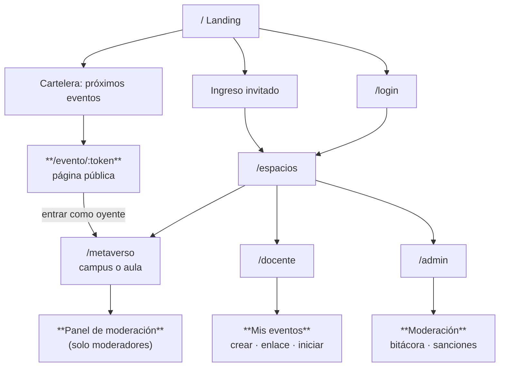
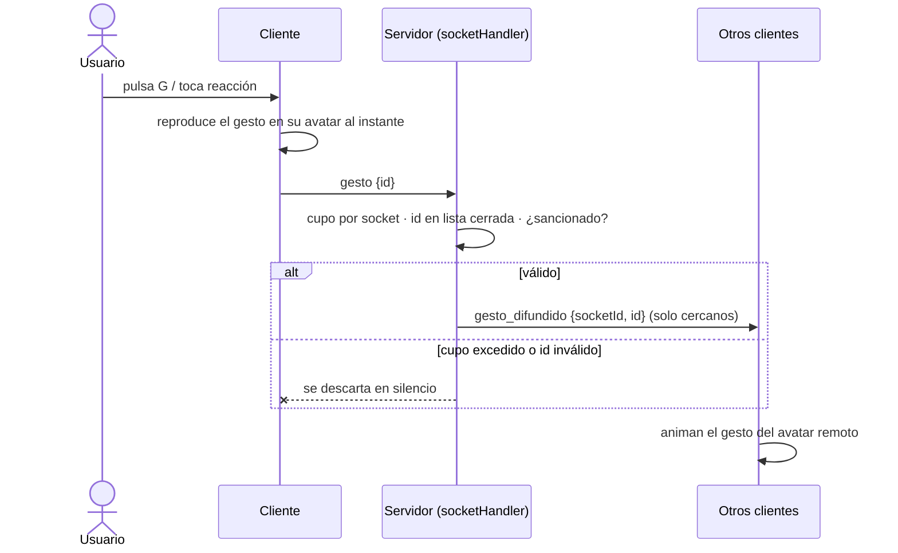
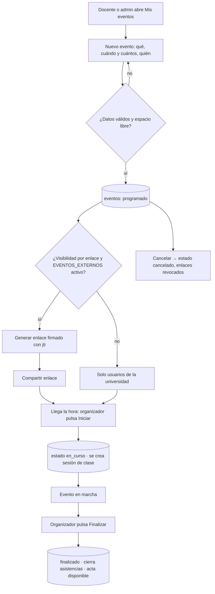
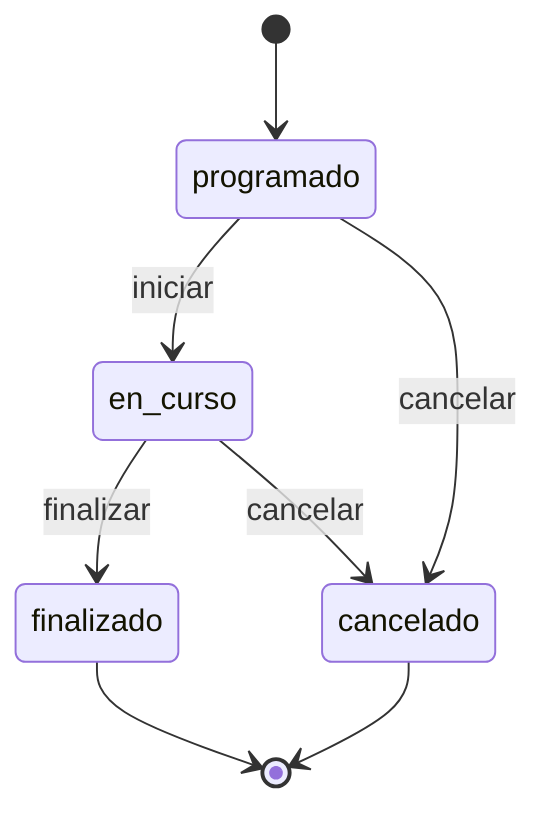
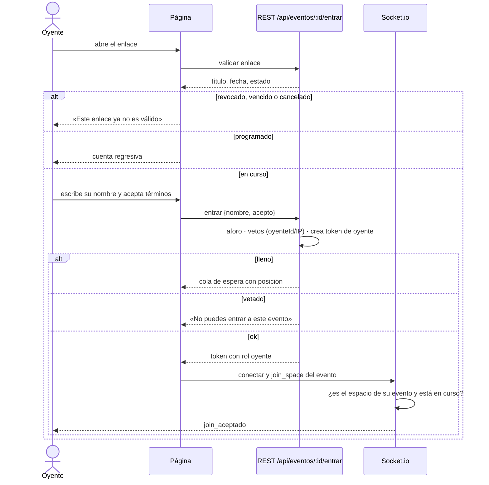
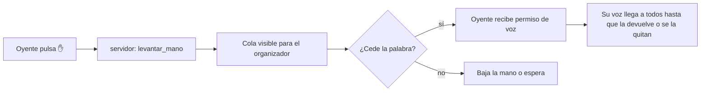
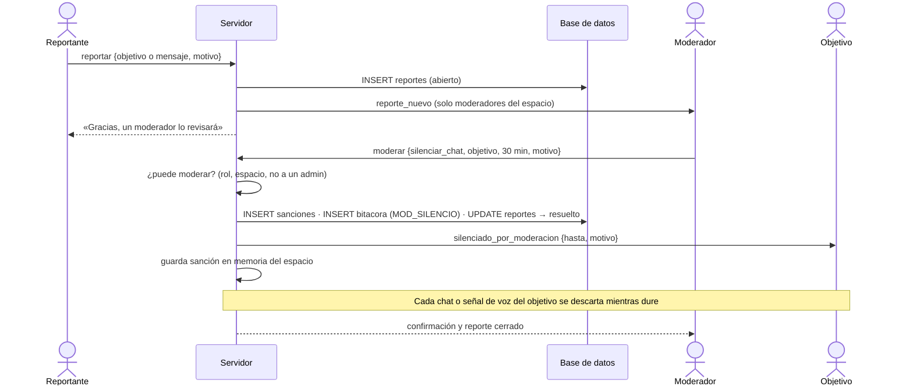
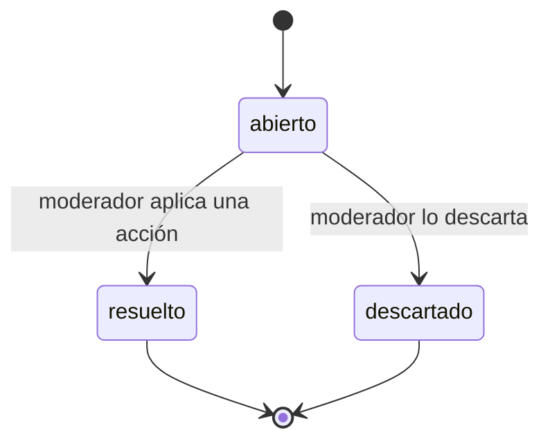
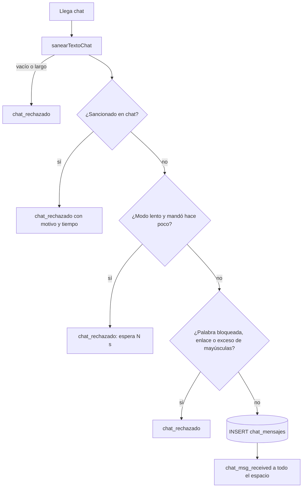

# App flow

Recorridos de usuario y de datos de las mejoras. Los diagramas son Mermaid (GitHub los dibuja). Para el informe impreso, la skill `uml-design` puede convertirlos en las figuras del estilo de `docs/uml/`.

## 1. Mapa de navegación

Rutas actuales (hash): `/`, `/login`, `/espacios`, `/metaverso`, `/admin`, `/docente`. Nuevas en negrita.

## 2. Quién ve qué

| Ruta o función | Invitado | Oyente | Estudiante | Docente | Admin |
|---|---|---|---|---|---|
| Landing y cartelera | ✔ | ✔ | ✔ | ✔ | ✔ |
| Campus | ✔ | — | ✔ | ✔ | ✔ |
| Aula propia | — | — | ✔ | ✔ | ✔ |
| Espacio de **su** evento | — | ✔ (solo en curso) | ✔ | ✔ | ✔ |
| Gestos y reacciones | ✔ | reacciones | ✔ | ✔ | ✔ |
| Voz (emitir) | ✔ campus | ✘ (con palabra cedida, sí) | ✔ | ✔ | ✔ |
| Chat | ✔ campus | si el evento lo permite | ✔ | ✔ | ✔ |
| Reportar | — | ✔ | ✔ | ✔ | ✔ |
| Crear evento | — | — | — | ✔ | ✔ |
| Moderar | — | — | — | su aula/evento | todo |

## 3. Flujo A — Gesto o reacción

Casos borde: sentado → gesto reducido; reacciones a todo el espacio; oyente → solo reacciones; en modo sin 3D, la reacción aparece en la lista de usuarios.

## 4. Flujo B — Organizar un evento

### Estados del evento

Un evento que pasa su `fin_programado` sin finalizarse lo cierra el admin o el organizador; no se cierra solo (mismo criterio que RNF-09 para las clases).

## 5. Flujo C — Entrada de un oyente

Salidas: cerrar la pestaña → `disconnect` anota `ultima_salida`; reingresar con el mismo token entra con el mismo `oyenteId` (los vetos y silencios siguen).

## 6. Flujo D — Pedir la palabra (oyente)

Reutiliza el mecanismo AULA-03; lo nuevo es que el oyente puede ser quien reciba la palabra.

## 7. Flujo E — Reportar y moderar

### Qué pasa con cada acción

| Acción | Efecto inmediato | Persistencia | Al reconectar |
|---|---|---|---|
| Silenciar voz | Se corta su micrófono y se descartan sus señales | `sanciones` con `hasta` | Sigue silenciado hasta `hasta` |
| Silenciar chat | `chat` devuelve `chat_rechazado` con el motivo | idem | idem |
| Expulsar | `expulsado`, sale del espacio, se cierra su tramo de asistencia | `sanciones` sin `hasta` | No puede volver a ese espacio mientras no se levante |
| Vetar (evento) | Igual que expulsar; para oyentes, por `oyenteId` + hash de IP | `sanciones.veto_evento` | `entrar` responde «No puedes entrar» |
| Eliminar mensaje | Desaparece del chat de todos | `chat_mensajes.eliminado_en` | No aparece en el historial |
| Levantar sanción | Vuelve a la normalidad | `levantada_en` | — |

### Estados de un reporte

## 8. Flujo F — Filtro de chat

El orden está fijado: primero sanear, luego sanción, luego reglas, luego guardar. Así un mensaje rechazado nunca se persiste.

## 9. Flujo G — Réplica de la facultad (resumen)
Plano (local, fuera de git) → medidas redondeadas en `planoCampus.ts` → geometría en `EdificiosUPDS.tsx` → pruebas de colisión y altura en `pruebas/unidad/planoCampus.test.mjs` → recorrido con `pruebas/escena/recorrer.mjs`. Detalle en el prompt dedicado.

## 10. Casos de error comunes

| Situación | Respuesta de la interfaz |
|---|---|
| Se cae la conexión del socket | Banner «Reconectando…»; al volver, se reaplica el estado (sanciones, evento) |
| El evento termina con oyentes dentro | Pantalla «El evento terminó» con enlace a la cartelera |
| Oyente recarga la página | Vuelve a entrar con su token si el evento sigue en curso |
| El organizador se desconecta | El evento sigue; el aforo y la voz dependen de él, se avisa a los oyentes |
| Moderador pierde el rol a mitad de sesión | Los roles se leen de la base en cada conexión; pierde el panel al reconectar |
| Flag apagado (`EVENTOS_EXTERNOS`, `MODERACION_ACTIVA`) | La función no se muestra; las rutas responden 404 |
