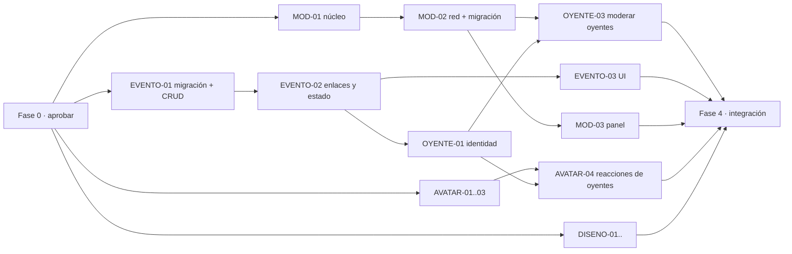

# Plan de implementación

Orden de trabajo para el [PRD](PRD.md), con el diseño del [TRD](TRD.md) y el [esquema](BACKEND_SCHEMA.md). Tamaños relativos: **S** ≈ medio día, **M** ≈ 1–2 días, **L** ≈ 3–5 días.

## 1. Reparto

| Campo | Responsable | Cómo se trabaja |
|---|---|---|
| A. Interacción del avatar | Tú con Claude (tarea de Pedro) | Sesión con el prompt de arranque ([PROMPT_SESION_FUNCIONALIDADES.md](../prompts/PROMPT_SESION_FUNCIONALIDADES.md)) |
| B. Pulir diseño | Ignacio | Rama propia; sigue [UIUX.md](UIUX.md) |
| C. Interacción de oyentes | Cristian | Rama propia; depende de D y E (§3) |
| D. Creación de eventos | Tú con Claude (tarea de Lucas) | Misma sesión que A y E |
| E. Moderación | Tú con Claude (tarea de Melvin) | Misma sesión que A y D |
| F. Réplica de la facultad | Tú con Claude | Sesión aparte ([PROMPT_REPLICA_FACULTAD.md](../prompts/PROMPT_REPLICA_FACULTAD.md)) |

## 2. Reglas de trabajo

- Una rama por tarea, desde `dev`, nombre `area-NN-descripcion` (p. ej. `avatar-01-gestos`). PR a `dev` con una aprobación y CI verde (Frontend y Backend).
- Si una tarea depende de un PR sin fusionar, la rama sale de la de ese PR y la descripción lo dice.
- **Conflictos:** se resuelven en la rama (`git merge dev`, `tsc`, pruebas) antes de pedir la fusión. Tras fusionar, se verifica que cada archivo del PR llegó a `dev`; ya se perdieron líneas dos veces resolviendo en GitHub.
- `App.tsx` (2 000 líneas) e `index.ts` (1 900) son cuellos de botella: los componentes y rutas nuevos van en **archivos propios**; en `App.tsx` solo entra la línea que los monta.
- Nada de refactor general mezclado con una funcionalidad.
- Migraciones: una por tarea que la necesite, con `.down.sql`. No se edita una fusionada.
- Antes de cada PR: `npm run lint && npm run test:unidad && npm run build` y `cd server && npm run build && npm run test:qa`.
- Cada tarea cierra con pruebas y con la fila del requisito actualizada en la propuesta de ingeniería.
- Lo que depende de una decisión institucional queda detrás de un flag, apagado.

## 3. Dependencias

Lo que arranca el día uno sin esperar a nadie: **AVATAR, DISENO, MOD-01, EVENTO-01**. Lo que va último: oyentes con voz y la cartelera.

## 4. Fases y tareas

### Fase 0 — Aprobación (antes de escribir código)
| ID | Tarea | Resultado |
|---|---|---|
| FASE0-01 | Revisar y aprobar PRD, TRD, esquema y este plan | Documentos aprobados o con cambios |
| FASE0-02 | Aprobar las migraciones 0011–0013 (tablas nuevas) | Visto bueno por escrito |
| FASE0-03 | Resolver o dejar como supuesto las 6 preguntas del PRD §7 | Tabla con «Responde» y fecha |
| FASE0-04 | Crear los flags `EVENTOS_EXTERNOS` y `MODERACION_ACTIVA` en `.env.example` | Apagados por defecto |

**Condición de salida:** documentos aprobados y las preguntas 1, 3 y 4 con dueño y fecha.

### Fase 1 — Base independiente (todo en paralelo)
| ID | RF | Tarea | Quién | Tamaño | Archivos principales | Listo cuando |
|---|---|---|---|---|---|---|
| AVATAR-01 | RF-19 | Gestos: lista cerrada, evento `gesto`, difusión a cercanos, animaciones en `AvatarModel`/`CuerpoAvatar` | Claude | M | `socketHandler.ts`, `limites.ts`, `mundo3d/AvatarModel.tsx`, nuevo `mundo3d/gestos.ts` | Dos navegadores: uno saluda y el otro lo ve; prueba unitaria de validación |
| AVATAR-02 | RF-19 | Rueda de gestos y atajos, `aria-live` | Claude | S | nuevo `RuedaGestos.tsx`, `index.css` | Usable con teclado y táctil |
| AVATAR-03 | RF-20 | Reacciones flotantes (sprites cacheados) | Claude | M | nuevo `mundo3d/Reacciones.tsx` | Sin fuga de texturas; `carga:render` sin caída |
| DISENO-01 | RF-23 | Completar tokens (espaciado, radios, z-index, movimiento) y documentarlos | Ignacio | S | `index.css` | Sin cambios visibles; sin colisiones de z-index |
| DISENO-02 | RF-23, RF-24 | Botones, campos, insignias, toasts, diálogos con todos sus estados | Ignacio | M | `index.css`, componentes | Checklist de UIUX §2.2 completo |
| MOD-01 | RF-37 | Núcleo puro: `puedeModerar`, `evaluarMensaje`, `estaSancionado` + pruebas | Claude | M | nuevo `server/src/moderacion.ts`, `pruebas/unidad/moderacion.test.mjs` | Pruebas verdes, sin tocar Express |
| EVENTO-01 | RF-29, RF-30 | Migración `0011`, `eventos.ts` (reglas de ventana y aforo, puro), CRUD y ciclo de vida | Claude | L | nueva migración, nuevo `eventos.ts`, `eventosServidor.ts` | `qa_suite` cubre crear, iniciar, finalizar y permisos |

### Fase 2 — Servidor de lo compartido
| ID | RF | Tarea | Quién | Tamaño | Depende de | Listo cuando |
|---|---|---|---|---|---|---|
| MOD-02 | RF-34, RF-35, RF-38 | Migración `0012`; reportar, moderar, sanciones en memoria y base, bitácora, borrado lógico de chat | Claude | L | MOD-01 | Silenciar corta chat y voz; sobrevive a recargar; fila en `bitacora` |
| MOD-02b | RF-37 | Filtro de chat y modo lento conectados a `chat` | Claude | M | MOD-02 | Orden sanear→sanción→reglas→guardar probado |
| EVENTO-02 | RF-31, RF-32 | Enlace firmado y revocable, inscripción, lista de asistentes | Claude | M | EVENTO-01 | Enlace revocado devuelve 410; aforo respetado |
| OYENTE-01 | RF-25 | Migración `0013`; token de oyente; `resolverIdentidad` con la rama oyente; `join_space` solo a su evento | Cristian (con Claude para la parte de socket si hace falta) | L | EVENTO-02 | Un oyente entra a su evento y a ningún otro; auditados todos los `esInvitado` |
| OYENTE-02 | RF-26, RF-27 | Permisos de oyente en servidor (reacciones, chat opcional, mano; sin pizarra/pantalla/grabar) | Cristian | M | OYENTE-01 | Prueba de sockets: acciones prohibidas se rechazan |
| AVATAR-04 | RF-20 | Reacciones disponibles para oyentes y en modo sin 3D | Claude | S | AVATAR-03, OYENTE-01 | Oyente reacciona y se ve |

### Fase 3 — Interfaz y voz
| ID | RF | Tarea | Quién | Tamaño | Depende de | Listo cuando |
|---|---|---|---|---|---|---|
| EVENTO-03 | RF-29, RF-32 | UI: crear evento (3 pasos), Mis eventos, copiar y revocar enlace | Claude | L | EVENTO-02 | Flujo completo en 360 px y escritorio |
| EVENTO-04 | RF-31 | Página pública `#/evento/:token` con estados | Cristian | M | EVENTO-02 | Estados antes/abierto/lleno/terminado/inválido |
| OYENTE-03 | RF-36 | Moderar oyentes: veto por `oyenteId` + hash de IP | Cristian con Claude | M | MOD-02, OYENTE-01 | Oyente vetado no reentra con el mismo enlace |
| OYENTE-04 | RF-26, RF-28 | Voz solo-recepción con tope; cola de espera; vista ligera | Cristian | L | OYENTE-01 | Con el harness de voz, 20 oyentes sin pasar el presupuesto del docente |
| MOD-03 | RF-39 | Panel de moderación, menú contextual, banner del sancionado, pestaña admin | Claude | L | MOD-02 | Flujo de UIUX §3.5 completo |
| AVATAR-05 | RF-22 | `E` unificada con indicador (sentarse, abrir) | Claude | M | AVATAR-02 | Indicador correcto por objeto cercano |
| DISENO-03 | RF-23, RF-24 | Landing, login, HUD y paneles con el sistema nuevo; revisión AA | Ignacio | L | DISENO-02 | Criterios de UIUX §6 |

### Fase 4 — Integración y cierre
| ID | RF | Tarea | Quién | Tamaño | Listo cuando |
|---|---|---|---|---|---|
| INT-01 | RF-25…RF-39 | Evento de punta a punta con 10 oyentes y moderación en vivo (sesión real) | Todos | M | Guion de prueba ejecutado sin bloqueos |
| INT-02 | RNF-10 | Medición: `carga:render`, `carga:trafico`, `carga:voz` contra la línea base de `dev` | Claude | S | Sin regresión; resultados anotados en `docs/decisiones` si cambia algo |
| EVENTO-05 | RF-33 | Cartelera en landing y letrero 3D del campus | Claude / Ignacio | M | Muestra próximos eventos |
| INT-03 | — | Actualizar `PROPUESTA_INGENIERIA_SOFTWARE.md` (estados de RF, endpoints, tablas, eventos de socket) y los diagramas UML afectados | Claude | M | Documentos al día |
| INT-04 | — | Decidir con la facultad los flags (supuestos 1, 3, 4) y activarlos | Quien dirige el proyecto | S | Flags en producción según decisión |

## 5. Línea de tiempo orientativa

| Semana | Tanda |
|---|---|
| 0 | Fase 0 |
| 1 | Fase 1: AVATAR-01..03, DISENO-01..02, MOD-01, EVENTO-01 |
| 2 | Fase 2: MOD-02, EVENTO-02, OYENTE-01..02 |
| 3 | Fase 3: EVENTO-03..04, MOD-03, OYENTE-03..04, AVATAR-05, DISENO-03 |
| 4 | Fase 4: integración, medición, documentación |

Es un orden, no una promesa: la unidad real es la condición de salida de cada fase, no la fecha.

## 6. Riesgos del plan

| Riesgo | Efecto | Respuesta |
|---|---|---|
| Tres personas no desarrollan | Carga concentrada en las sesiones con Claude | Los tres campos comparten servidor (gestos, eventos, moderación) y se hacen en la misma sesión para no duplicar contexto |
| OYENTE depende de EVENTO y MOD | Cristian se bloquea | Cristian empieza por EVENTO-04 (página pública, sin depender del servidor real) y por la auditoría de `esInvitado` |
| Voz con muchos oyentes | El docente no sostiene 20+ flujos de subida | Medir en INT-02; si no, tope más bajo o plan B SFU (ADR 0001) |
| Respuesta institucional tardía | Funciones listas pero apagadas | Flags apagados; propuesta escrita lista (PRD §7) |
| Choques en `App.tsx` | Fusiones difíciles | Componentes en archivos propios; PRs chicos; fusión en orden |
| Prueba con 30 personas reales | No se consigue | Alternativas ya acordadas: más máquinas o prueba distribuida; no volver a pedir la sesión |

## 7. Qué se pregunta antes de hacer

Siguiendo los puntos de control de trabajo: antes de crear cada **tabla, endpoint, dependencia o módulo nuevo** que no esté en este plan; antes de cualquier commit, push, merge o PR; y antes de tocar código de otro equipo. Lo que ya está en este documento y fue aprobado en la Fase 0 no se vuelve a preguntar.
